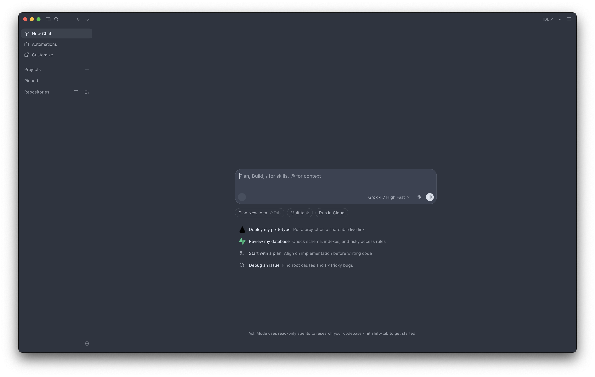
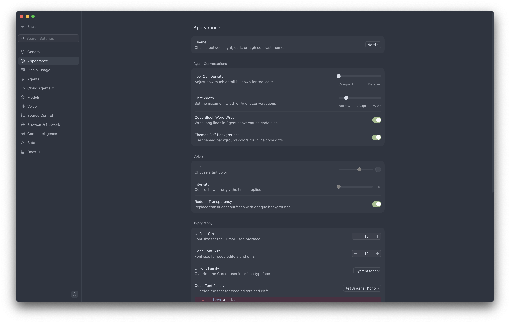

# Nord Theme for Cursor

Nord (Polar Night) for the [Cursor](https://cursor.com) editor's UI chrome — a custom **glass theme** written into Cursor's theme store, plus the official Nord VS Code extension for editor syntax colors. No Cursor binaries are patched; this only writes theme records and settings.



*Main window — sidebar, chrome, and canvas in Polar Night.*



*Settings → Appearance with the glass theme's Nord record active: Hue 220, Intensity 0, Reduce Transparency on — exactly the values `apply.sh` writes.*

## What gets themed

| Surface | Value |
|---|---|
| Sidebar, chrome (title/toolbar), panes | `#2e3440` (nord0) |
| Elevated surfaces — menus, dropdowns, meta panels | `#3b4252` (nord1) |
| Base foreground | `#d8dee9` (nord4) |
| Accent / focus ring | `#88c0d0` (nord8, frost) |
| Git status (modified/removed/untracked) | `#ebcb8b` / `#bf616a` / `#a3be8c` |
| Terminal ANSI palette | full Nord mapping (see [`glass-theme.json`](glass-theme.json)) |

Editor **syntax** colors come from the [Nord Visual Studio Code](https://marketplace.visualstudio.com/items?itemName=arcticicestudio.nord-visual-studio-code) extension via `workbench.colorTheme: Nord`.

## What's *not* directly themed

**The editor and chat canvas colors.** Cursor's glass custom-theme fields have no editor-color token — those surfaces follow the VS Code workbench theme instead. That's why this mod also sets `workbench.colorTheme: Nord` and registers the glass theme with `vscodeThemeSettingsId: Nord`, so theme sync keeps them aligned and the canvas renders the same nord0 `#2e3440` you see in the screenshot. If some view ever shows a dark canvas, it's a surface neither the glass tokens nor the workbench theme reach.

Also note tint: `customTintHue` is `220` with `customTintIntensity` `0` — the glass tint stays neutral and the Nord blue comes from the explicit token values, not the tint.

## Requirements

- macOS (paths are macOS; the SQL/JSON logic is portable if you adjust them)
- Cursor
- `python3` (for the sqlite + JSON edits; also used by `verify.py`)

## Quick start

```bash
git clone https://github.com/willio/nord-theme-for-cursor.git
cd nord-theme-for-cursor

# 1) FULLY QUIT Cursor first (Cmd+Q). A window reload can flush the in-memory
#    theme back over the database file and undo the write.
./apply.sh

# 2) Open Cursor — the chrome should be Polar Night.
python3 verify.py
```

`apply.sh` refuses to run while Cursor is open, backs up `state.vscdb` and `settings.json` (timestamped, alongside the originals), then upserts the theme keys and installs the settings. If the Nord extension is missing it prints install instructions (Extensions panel, or `cursor --install-extension arcticicestudio.nord-visual-studio-code`).

## Uninstall

```bash
# fully quit Cursor first
./restore.sh
```

Restores the newest pre-apply backups of the database and settings.

## How it works

Cursor's Settings → Appearance panel is the **glass theme** system, separate from `workbench.colorTheme`. Its menu doesn't list marketplace themes; a custom theme must be registered in the `ItemTable` of `~/Library/Application Support/Cursor/User/globalStorage/state.vscdb`:

| Key | Written value |
|---|---|
| `glass.theme.settingsId` | `cursor-custom-theme:nord` |
| `glass.theme.darkSettingsId` | `cursor-custom-theme:nord` |
| `glass.theme.customThemesV1` | the record in [`glass-theme.json`](glass-theme.json) |
| `glass.theme.customTintHue` | `220` |
| `glass.theme.customTintIntensity` | `0` |
| `glass.theme.detectColorScheme` | `false` |
| `cursor.themeSync.enabled` | `true` |

(`glass.theme.lightSettingsId` is left untouched.) The theme record maps Cursor's glass tokens onto the official Nord palette — surfaces per the table above, aurora colors for status/semantic tokens, and a full Nord terminal ANSI set.

With theme sync on, glass keeps `workbench.colorTheme` aligned to the glass theme's base, which is why `workbench.colorTheme` is also set to `Nord` — the extension then provides editor syntax colors that match.

The apply/restore scripts were tested against **copies** of a real `state.vscdb`: applying from a pre-Nord state passes all 11 checks in `verify.py`, and restoring returns the database and settings byte-identical to the pre-apply state.

## Troubleshooting

- **Nothing changed** — Cursor was probably still running (or got reloaded) during the write. Fully quit it and re-run `./apply.sh`.
- **Sidebar is Nord but the editor is black** — that's the documented limitation above, not a failed apply.
- **Syntax colors are wrong** — install the Nord VS Code extension and confirm `workbench.colorTheme: Nord` in settings.

## Disclaimer

Unofficial community mod; not affiliated with Anysphere/Cursor. The Nord palette is by [Arctic Ice Studio](https://github.com/arcticicestudio/nord) (MIT). Theme writes are reversible via the backups `apply.sh` takes.

## License

[MIT](LICENSE)
